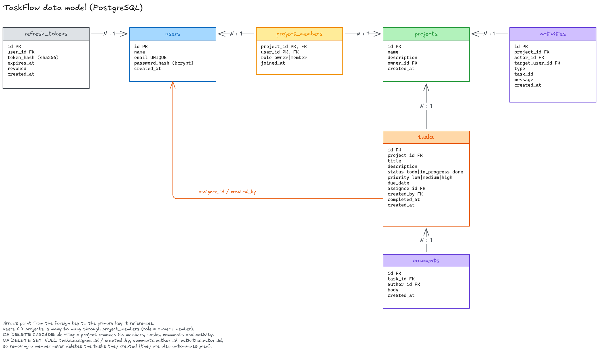

# TaskFlow

A collaborative task-board (small Trello/Jira) where users create projects, invite teammates by email, and manage tasks on a board with **live updates over WebSockets**. Includes per-project roles (owner/member), comments, an activity feed, an "Assigned to me" view and a personal dashboard.

**Stack:** React (Vite) · Python + FastAPI · PostgreSQL (SQLAlchemy 2 + Alembic) · native FastAPI WebSockets · JWT + refresh tokens · bcrypt.


## Run it

Prerequisites: Python 3.11+, Node 18+, PostgreSQL running locally.

```bash
# 1. Database
createdb taskflow            # or: psql -U postgres -c "create database taskflow"

# 2. Backend
cd backend
python -m venv .venv && source .venv/bin/activate     # Windows: .venv\Scripts\activate
pip install -r requirements.txt
cp .env.example .env         # edit DATABASE_URL (user/password) and JWT_SECRET
alembic upgrade head         # create tables
python seed.py               # demo users + shared project
uvicorn app.main:app --reload --port 8000

# 3. Frontend (second terminal)
cd frontend
npm install
npm run dev                  # http://localhost:5173  (proxies /api and /api/ws to :8000)
```

**Demo logins** (password `Password123`): `alice@example.com` (owner of "Website Redesign") and `bob@example.com` (member, already has a task assigned). Open two browser windows (one normal, one private) and log in as each to see real-time behaviour.

Tests: `cd backend && pytest -q` (auth, refresh rotation, role enforcement, assignment rules, pagination, cascade deletes; uses the configured DB with unique emails).

## Data model




| Table | Key columns / notes |
|---|---|
| `users` | name, unique email, `password_hash` (bcrypt) |
| `refresh_tokens` | `token_hash` (SHA-256), expires_at, revoked, user_id |
| `projects` | name, description, owner_id |
| `project_members` | PK (project_id, user_id), `role`. Cascade-deleted with the project |
| `tasks` | project_id (CASCADE), title, description, status, priority, due_date, `assignee_id` (SET NULL), `created_by` (SET NULL), `completed_at` |
| `comments` | task_id (CASCADE), author_id (SET NULL), body, created_at |
| `activities` | project_id (CASCADE), actor_id, target_user_id, type, task_id, message |

Integrity rules: deleting a project cascades to members, tasks, comments and activity (no orphans). Removing a member deletes only their membership row; tasks they created remain, and tasks assigned to them are auto-unassigned (in the same transaction), so a removed user can never stay assigned. Indexes on `tasks(project_id,status)`, `tasks(project_id,assignee_id)`, `project_members(user_id)`.

## Key rules (all enforced on the backend)

- Password: ≥ 8 chars, at least one letter and one digit; email validated; bcrypt hash.
- Non-members get **404** for any project resource (existence isn't leaked); members-only actions return **403**. Only the owner can invite/remove members or delete the project.
- Task validation: non-empty title, due date not in the past on creation, assignee must be a project member (422).
- Only the task's assignee or the owner can move a task to **Done** (403 otherwise). `completed_at` is set on entering Done and cleared when leaving it.
- Backlog list (`GET /projects/{id}/tasks`) does filtering (assignee + priority), title search, sorting (priority / due date / created) and pagination in SQL with `LIMIT/OFFSET`; returns `{items,total,page,pages}`.
- Unauthenticated or expired access token → **401**.

## Refresh-token flow

- **Access token**: JWT, 15 min. Stored **only in JS memory** (not localStorage), so XSS can't exfiltrate a long-lived credential. Sent as `Authorization: Bearer`.
- **Refresh token**: random 48-byte value, 7 days, set as an **httpOnly, SameSite=Lax cookie** scoped to `/api/auth`. The DB stores only its SHA-256 hash.
- **On expiry**: the API returns 401 → the client's `api()` wrapper calls `/auth/refresh` (single-flight, so parallel requests share one refresh) and **retries the original request once**. If the refresh also fails it logs the user out.
- **Rotation**: every refresh revokes the old token and issues a new one. Re-using an already-rotated token revokes all of that user's sessions (theft detection). Logout revokes the token and clears the cookie.
- On page reload the app calls `/auth/refresh` to restore the session from the cookie.

## WebSockets

I used FastAPI's native WebSocket support (`/api/ws`) rather than polling: no extra dependency, and it shares the same JWT/DB code as the REST API.

- **Authentication**: the client connects with `?token=<access JWT>` (browsers can't set headers on WebSockets). The token is verified at the handshake; invalid/expired tokens are rejected before the connection is accepted.
- **Scoping, not broadcast**: an in-process hub keeps two kinds of rooms: *project rooms* and *user rooms*. A client must send `subscribe {project_id}`; the server **re-checks membership in the DB** before adding it to that room (non-members get `forbidden`). Task/comment/member events are published only to that project's room. "Assigned to me" updates go to the assignee's personal user room (`assigned.changed`), including the previous assignee on reassignment. When a member is removed their sockets are evicted from the room and they get `project.removed`.
- **Mutations always go through REST**; the server writes to the DB, commits, then publishes the event. The socket is a notification channel, so the app is fully functional without it.
- **Disconnects**: the client reconnects with exponential backoff (1s → 15s), refreshing the access token first if the handshake was rejected, re-subscribes to the open projects, then fires a `resync` that makes views refetch anything missed. A header badge shows Live / Reconnecting. A manual refresh always gets current state from REST.
- Limitation: the hub is in-memory, so it assumes a single backend process (see below).

## Stack choices

FastAPI for typed validation (Pydantic gives the inline field errors the UI shows) and native WebSockets; PostgreSQL for real relational constraints (composite-key membership, FK cascades/SET NULL); React + Vite for a small SPA, with a Vite dev proxy so the refresh cookie stays same-origin; plain CSS to keep the code explainable.

## Frontend quality

Every data view has loading and error (with Retry) states; forms show inline field errors (client-side checks mirror the server rules, and server 422 messages are mapped back onto fields); every request button is disabled with a "Working…" state while in flight. Bonus: drag-and-drop between board columns with optimistic update + rollback on failure (e.g. the "only assignee/owner can mark Done" error).

## What was hard

- **Permission rules on partial updates**: the Done check must use the assignee *as it will be after the update* (assigning and completing in one PATCH), and non-members must be indistinguishable from "not found".
- **Scoping socket events**: designing rooms keyed by project and user, verifying membership at subscribe time, and handling removal/deletion (evict + notify) rather than a global broadcast.
- **Sync routes + async sockets**: route handlers run in a threadpool, so they hand events to the server's event loop with `run_coroutine_threadsafe`.

## Known issues / incomplete

- The WebSocket hub is in-process: multiple backend workers would need a Redis pub/sub layer.
- Invited users are added immediately (no accept/decline). Ownership transfer isn't implemented.
- Task ordering within a column isn't user-controlled. No email notifications. No Docker Compose.
- Backend tests are API-level; there are no frontend tests, and the UI was verified manually/by build rather than with automated browser tests.

## With more time

Redis pub/sub for sockets, invitation accept flow, per-column ordering, cursor pagination, frontend tests (Vitest/Playwright), Docker Compose, CI.

## Where I used AI and what I learned

I used AI (Claude Code) mainly for the **frontend** (React): the page layouts, the board / backlog / dashboard screens, the task modal and the styling. I then read through it, ran it and checked how it behaves rather than taking it as-is.

What I learned from it:

- **Access token in memory, refresh token in an httpOnly cookie.** Keeping the short-lived token out of `localStorage` means XSS can't steal a long-lived credential. On a 401 the client refreshes once and retries the request; parallel requests share a single refresh call so the rotating refresh token isn't used twice.
- **How the WebSocket client works.** It connects with the access token, subscribes to a project, reconnects with exponential backoff after a drop, and then refetches (`resync`) so nothing missed while offline is lost. The REST API is the source of truth; the socket only tells the UI when to update.
- **Loading / error / in-flight state patterns.** Small hooks (`useAsync`, `useAction`) give every view a loading and error state and stop double-submits, instead of repeating that logic in every component.
- **Optimistic updates with rollback.** Dragging a card moves it immediately and puts it back with a clear message if the server rejects it (for example the "only the assignee or owner can mark Done" rule).

